# Project BlueTeam Security: Hardened Linux Server Lab

A multi-VM defensive security lab built in **Oracle VirtualBox**. A hardened **Ubuntu Server** runs web, FTP and SMB services behind a default-deny firewall with automated brute-force protection. A **Kali Linux** machine plays the attacker, a **Xubuntu** machine plays a normal user, and the **Windows host** manages the server over a separate host-only network.

The lab's main result is **network segmentation that I verified with scans from both sides**: from the lab network the services are open and SSH is blocked, and from the management network SSH is open and the services are blocked.

---

## Table of Contents

1. [Objectives](#objectives)
2. [Lab Architecture and Devices](#lab-architecture-and-devices)
3. [Tools & Technologies](#tools--technologies)
4. [Setup Steps and Commands](#setup-steps-and-commands)
5. [Verification Results](#verification-results)
6. [Screenshots](#screenshots)
7. [Security Design Decisions](#security-design-decisions)
8. [Observations & Next Steps](#observations--next-steps)
9. [Skills Demonstrated](#skills-demonstrated)

---

## Objectives

- Provision a server with a **static IP** and a separate management interface.
- Harden the server with a **default-deny** firewall and least-privilege access.
- Restrict and rate-limit **SSH** to a single trusted management host.
- Deploy **Fail2ban** to detect and block repeated failed logins.
- Run web, FTP and SMB services reachable **only from the lab subnet**.
- Enable firewall **logging** for later SOC-style review.
- Validate the configuration by scanning from an attacker machine (Kali) and from the management host (Windows with Zenmap).

## Lab Architecture and Devices

The lab uses **two virtual networks** so that management traffic is kept apart from lab traffic.

| Network | Type | Range | Purpose |
|---------|------|-------|---------|
| `CyberLab_NAT` | VirtualBox NAT Network | `10.0.20.0/24` (gateway `10.0.20.1`) | Lab traffic between the server, Kali and Xubuntu |
| Management network | VirtualBox Host-Only | `192.168.110.0/24` | Out-of-band SSH access from the Windows host |

| Device | Role | Address | Notes |
|--------|------|---------|-------|
| Ubuntu Server 22.04.5 LTS (`ubuntu-lab`) | Defended server | `10.0.20.10` static (`enp0s3`) | Runs Fail2ban, UFW, Nginx, vsftpd, Samba |
| Ubuntu Server, management interface | SSH link | `192.168.110.103` DHCP (`enp0s8`) | Reachable only for SSH, from the Windows host |
| Windows host | Management and scanning | `192.168.110.1` (host-only adapter) | PowerShell SSH client, Zenmap |
| Kali Linux | Attacker/RedTeamer | DHCP on `10.0.20.0/24` | Reconnaissance against the server |
| Xubuntu | Lightweight client | DHCP on `10.0.20.0/24` | Normal user of the web and FTP services |

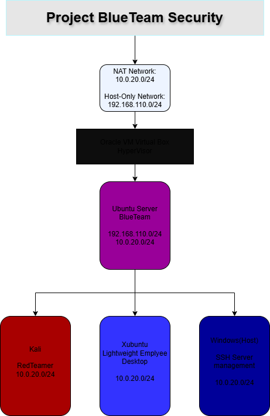

## Tools & Technologies

| Category | Tools |
|----------|-------|
| Virtualisation | Oracle VirtualBox (NAT Network and Host-Only adapters) |
| Operating systems | Ubuntu Server 22.04.5 LTS, Kali Linux, Xubuntu, Windows |
| Network configuration | Netplan (systemd-networkd) |
| Firewall | UFW (Uncomplicated Firewall) |
| Intrusion prevention | Fail2ban |
| Services | Nginx (HTTP), vsftpd (FTP), Samba (SMB) |
| Remote access | OpenSSH, Windows PowerShell |
| Scanning | Nmap, Zenmap |

---

## Setup Steps and Commands

### Ubuntu Server

**Static IP (steps 1 to 4).** The server has two adapters: `enp0s3` on the NAT Network (static) and `enp0s8` on the host-only network (DHCP).

1. Edit the Netplan file: `sudo nano /etc/netplan/00-installer-config.yaml`

```yaml
network:
  version: 2
  renderer: networkd
  ethernets:
    enp0s3:
      dhcp4: false
      addresses:
        - 10.0.20.10/24
      routes:
        - to: default
          via: 10.0.20.1
      nameservers:
        addresses:
          - 8.8.8.8
          - 1.1.1.1
    enp0s8:
      dhcp4: true
```

2. Restrict file permissions: `sudo chmod 600 /etc/netplan/00-installer-config.yaml`
3. Apply the configuration: `sudo netplan apply`
4. Verify: `ip a show enp0s3`

> Note: YAML needs spaces, not tabs.

**Startup commands**

5. `sudo apt update`
6. `sudo apt install -y fail2ban`

**Fail2ban running confirmation**

7. `sudo systemctl enable --now fail2ban`
8. `sudo fail2ban-client status`

**SSH hardening**

9. `sudo ufw default deny incoming`
10. `sudo ufw default allow outgoing`
11. `sudo ufw limit from 192.168.110.1 to any port 22 proto tcp`
12. `sudo ufw logging medium`
13. `sudo ufw enable`
14. `sudo ufw status verbose`

> Note: **Order matters.** The SSH rule must exist before `ufw enable` or you will lock yourself out of the server.

**More services: web server (port 80), FTP (port 21) and SMB (port 445)**

15. `sudo apt install -y nginx vsftpd samba`
16. `sudo systemctl enable --now nginx vsftpd smbd`

**Opening the service ports to the lab subnet only**

17. `sudo ufw allow from 10.0.20.0/24 to any port 80 proto tcp`
18. `sudo ufw allow from 10.0.20.0/24 to any port 21 proto tcp`
19. `sudo ufw allow from 10.0.20.0/24 to any port 445 proto tcp`

### Windows (Host)

- SSH into the Ubuntu Server over the **host-only** network.
- In PowerShell: `ssh ubuntu-sec@192.168.110.103`
- Enter the password.
- Use **Zenmap** (Nmap with a GUI) to scan the server at `192.168.110.103`.

### Kali (Attacker/RedTeamer)

- Check the DHCP address on `CyberLab_NAT`: `ip a`
- Discover live hosts on the lab subnet: `nmap -sn 10.0.20.0/24`
- Scan the server for open services: `nmap -sV -p 21,80,445 10.0.20.10`
- Test the firewall SSH block (should time out or be blocked): `ssh ubuntu-sec@10.0.20.10`

### Xubuntu Client

- Check the DHCP address on `CyberLab_NAT`: `ip a`
- Test web server access: open a browser and go to `http://10.0.20.10`
- Test FTP server access: `ftp 10.0.20.10`

---

## Verification Results

The same server, scanned from the two networks gives opposite results. This is the intended outcome of the firewall rules.

| Scanned from | Target | 21 (FTP) | 22 (SSH) | 80 (HTTP) | 445 (SMB) |
|--------------|--------|----------|----------|-----------|-----------|
| Kali, lab network | `10.0.20.10` | open | **filtered** | open | open |
| Windows host, management network | `192.168.110.103` | filtered | **open** | filtered | filtered |

SSH works only from the management host, and the services work only from the lab subnet.

---

## Screenshots

### 1. Static IP on the lab interface

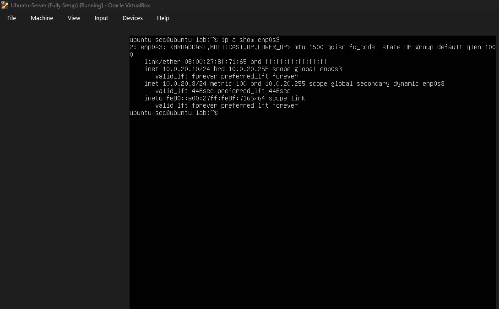

`ip a show enp0s3` confirms the static address `10.0.20.10/24` is bound to the NAT-network adapter. It also shows a second, dynamic address (`10.0.20.3/24`, flagged `secondary dynamic`) on the same interface, which is covered under [Observations](#observations--next-steps).

### 2. Fail2ban installed and enabled

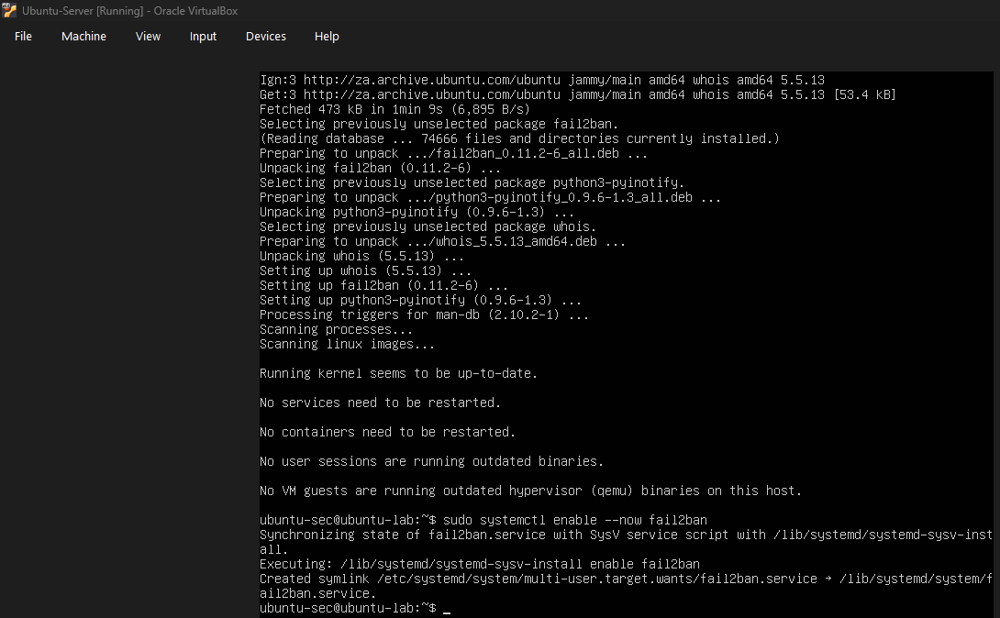

The package install completes (Fail2ban 0.11.2 with its `python3-pyinotify` and `whois` dependencies, from the Ubuntu 22.04 "jammy" repositories). `sudo systemctl enable --now fail2ban` then creates the systemd link so the service starts now and on every boot.

### 3. Firewall default policies

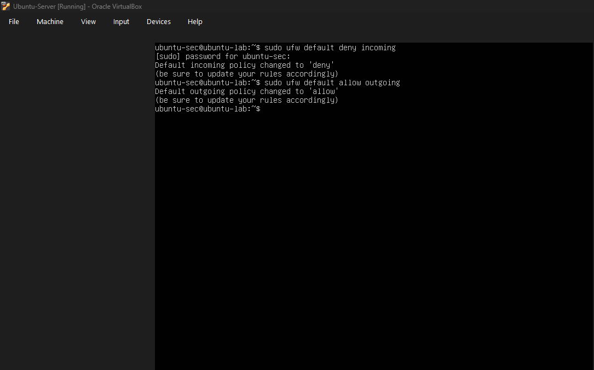

`sudo ufw default deny incoming` and `sudo ufw default allow outgoing` set the default-deny posture. UFW confirms both policy changes and reminds you to update your rules, which is why the SSH rule must be added before enabling the firewall.

### 4. Installing the server services

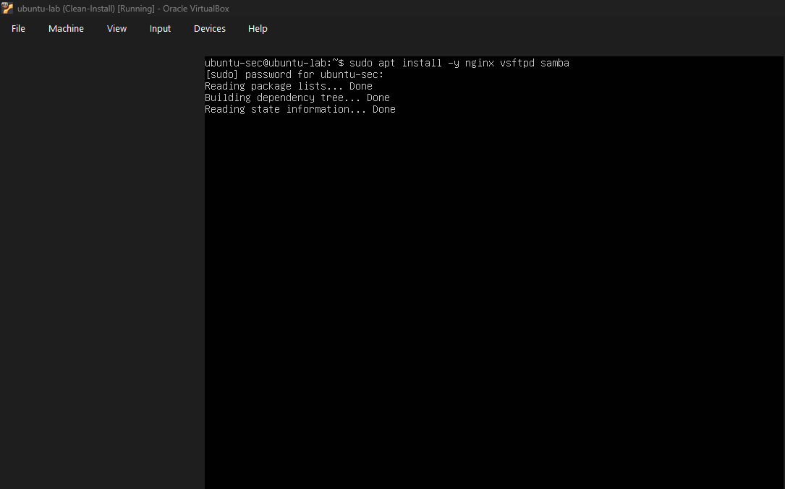

`sudo apt install -y nginx vsftpd samba` installs the web, FTP and file-sharing services that make up the lab's attack surface.

### 5. Opening service ports to the lab subnet only

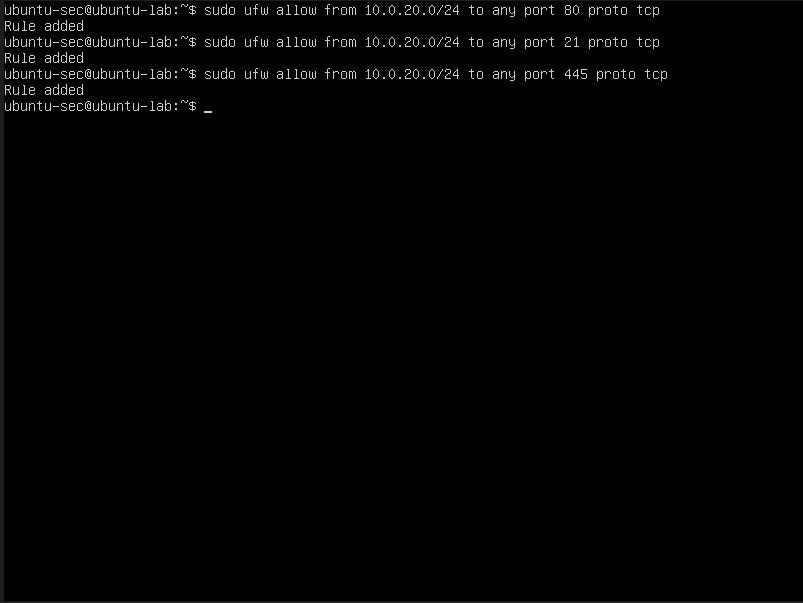

Three UFW rules allow TCP ports 80, 21 and 445, each restricted to the source range `10.0.20.0/24`. UFW answers "Rule added" for each one. Nothing outside the lab subnet can reach these services.

### 6. SSH from the Windows host

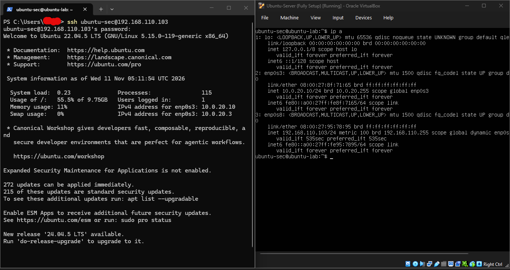

PowerShell on the Windows host runs `ssh ubuntu-sec@192.168.110.103` and logs in to Ubuntu 22.04.5 LTS (kernel 5.15.0-119-generic). The login banner shows the server's two interfaces: `10.0.20.10` on `enp0s3`, plus the management link. The VirtualBox console on the right shows the same `ip a` output, proving the SSH session reaches this VM through the host-only network.

### 7. Inside the SSH session

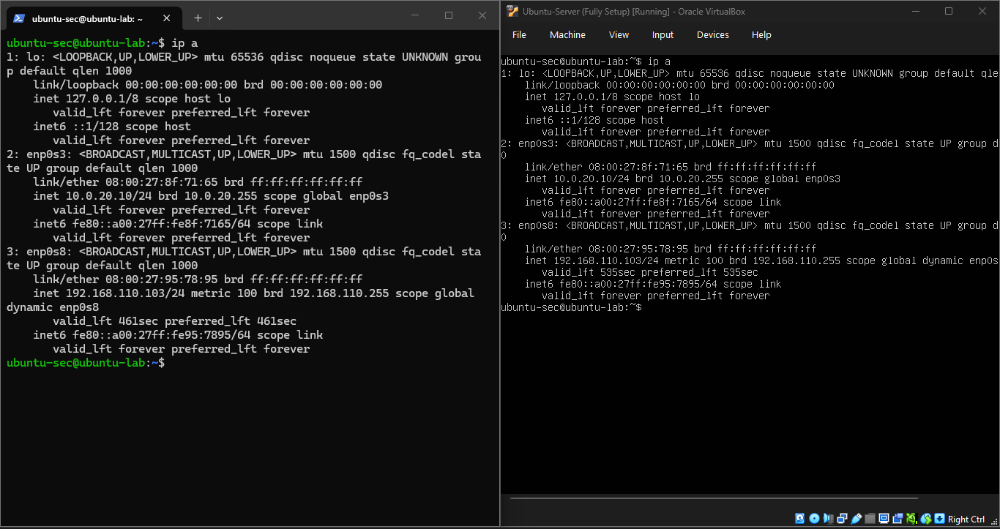

`ip a` run in the SSH session (left) matches the server console (right): `enp0s3` is `10.0.20.10/24` (static) and `enp0s8` is `192.168.110.103/24` (dynamic).

### 8. Zenmap scan from the management host

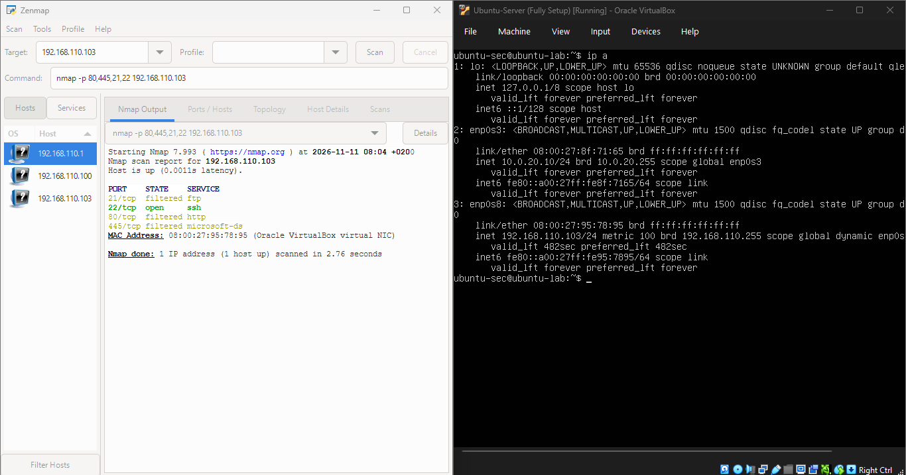

Zenmap on the Windows host runs `nmap -p 80,445,21,22 192.168.110.103`. Result: **22/tcp open (ssh)**, while 21, 80 and 445 are **filtered**. This proves that the firewall exposes SSH to the management host only and hides the services. Zenmap's host list also shows `192.168.110.1`, `.100` and `.103` on the host-only network.

### 9. Host discovery from Kali

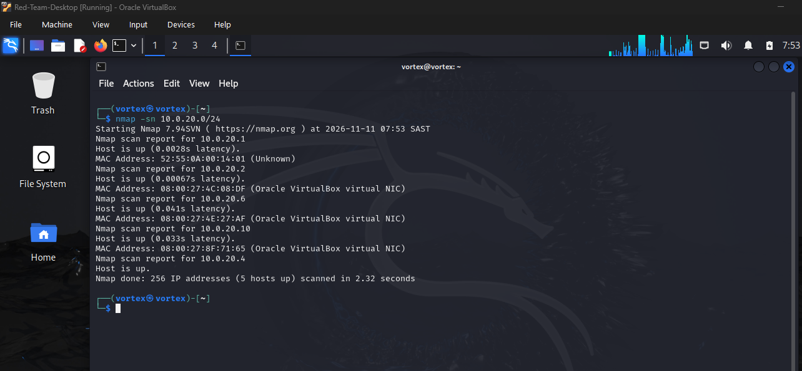

`nmap -sn 10.0.20.0/24` from Kali finds **5 hosts up** on the lab network: the gateway `10.0.20.1`, `10.0.20.2`, `10.0.20.6`, the server `10.0.20.10` (its MAC `08:00:27:8F:71:65` matches `enp0s3` in the earlier screenshots), and `10.0.20.4`, shown without a MAC address, which is how Nmap lists the scanning machine itself. This is the reconnaissance step an attacker would take first.

### 10. Service scan from Kali

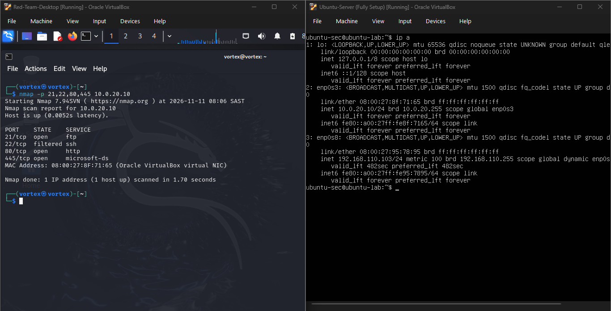

`nmap -p 21,22,80,445 10.0.20.10` from Kali (left) reports **21/tcp open (ftp)**, **22/tcp filtered (ssh)**, **80/tcp open (http)** and **445/tcp open (microsoft-ds)**. The server console (right) shows its addresses. The attacker can see and reach the three services but cannot reach SSH, so the firewall blocks it as designed.

### 11. SSH Kali Denial


Running `ssh ubuntu-sec@10.0.20.10` from Kali on the lab network fails with `Connection timed out` on port 22. UFW only allows SSH from the management host (`192.168.110.1`), so the firewall silently drops the attacker's connection attempt. The session never starts and no login prompt appears, which effectively locks the attacker out of SSH. This matches the **filtered** SSH port in the Nmap scan, where the web, FTP and SMB services stay reachable but SSH does not.

---

## Security Design Decisions

| Decision | Reason |
|----------|--------|
| Separate management network (host-only) | Keeps administration traffic off the network an attacker can reach |
| Default deny on incoming traffic | Reduces the attack surface to only what is explicitly permitted |
| SSH allowed from one host only | Other machines, including a compromised lab host, cannot reach SSH |
| `ufw limit` on SSH | Throttles brute-force attempts at the firewall level |
| Fail2ban | Automatically bans sources that repeatedly fail authentication |
| Services open to `10.0.20.0/24` only | Services stay reachable inside the lab but not beyond it |
| Firewall logging at `medium` | Produces logs that can be analysed later |
| Static IP on the lab interface | Gives predictable addresses for firewall rules and testing |

## Observations & Next Steps

Issues I spotted while reviewing my own evidence:

- **Duplicate address on `enp0s3`.** Screenshot 1 shows a dynamic `10.0.20.3/24` next to the static `10.0.20.10/24`, so another DHCP-enabled network config may still be active. Next step: check `/etc/netplan/` for other files and make sure only the static config applies.
- **Pending updates.** The login banner reports 272 updates available, 215 of them security updates. Next step: run `sudo apt update && sudo apt upgrade`.
- **Small root disk.** The root filesystem is about 9.75 GB and 55.5% used, so keep an eye on log growth.

Planned work:

- Run `sudo fail2ban-client status` and capture the active `sshd` jail.
- Simulate SSH brute-force attempts and capture Fail2ban bans.
- Review `/var/log/ufw.log` and write up the blocked scans as incident-style reports.
- Forward the logs to a SIEM for alert triage (next project).

## Skills Demonstrated

- Multi-network design in VirtualBox (NAT Network plus Host-Only)
- Linux server administration and service management (`systemd`)
- Static IP provisioning with Netplan
- Host firewall configuration and rule ordering (UFW)
- SSH hardening and brute-force mitigation
- Intrusion prevention with Fail2ban
- Network segmentation by source subnet
- Network reconnaissance and validation with Nmap and Zenmap
- Reading scan output and documenting evidence

---

*Built as part of my SOC / cybersecurity analyst portfolio.*
